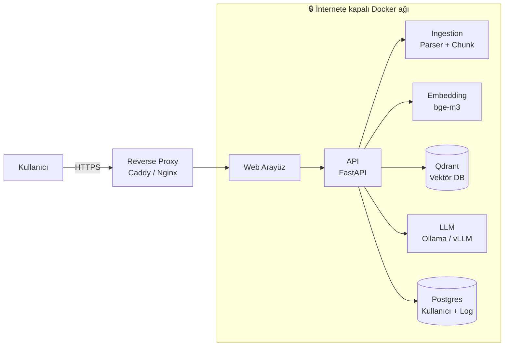

# 🔒 Private RAG: Roadmap

> [!abstract] Tek cümlelik ürün
> **Verisi kurumdan asla çıkmayan, cevaplarında kaynak gösteren, Docker ile tek komutta kurulan doküman asistanı.**

> [!tip] Satış cümlesi (İngilizce)
> "Your documents never leave your server. Every answer cites the exact page it came from."

---

## 1. Büyük Resim



---

## 2. Teknoloji Yığını

| Katman | Seçim | Not |
|---|---|---|
| LLM (geliştirme) | Ollama, 7-9B Q4 | 4060 laptop için |
| LLM (production) | vLLM | Çok kullanıcı, yüksek hız |
| Embedding | bge-m3 | Çok dilli, CPU'da çalışır |
| Reranker | bge-reranker-v2-m3 | Kaliteyi ciddi artırır |
| Vektör DB | Qdrant | Hibrit arama destekler |
| Doküman okuma | Docling / Unstructured + OCR | Taranmış PDF için OCR şart |
| API | FastAPI | |
| Arayüz | Open WebUI → sonra özel arayüz | İlk aşamada hazır kullan |
| Kullanıcı/log DB | PostgreSQL | |
| Proxy / TLS | Caddy | Otomatik sertifika |
| Paketleme | Docker Compose | Tek komut kurulum |

> [!note] Model seçimi
> Güncel en iyi 7-9B model sürekli değişiyor. İndirmeden önce [ollama.com/library](https://ollama.com/library) ve güncel karşılaştırmalara bak. Modeli sabit tutma, test setinle ölç.

---

## 3. Güvenlik Mimarisi (Ana Satış Noktası)

> [!warning] Kural
> "Veri dışarı çıkmaz" iddiasını **kanıtlayabilmelisin**. Söylemek yetmez, doğrulama adımları aşağıda.

### 3.1 Ağ izolasyonu
- [ ] Docker ağını `internal: true` yap (konteynerler internete çıkamaz)
- [ ] Sadece reverse proxy dışarıya/kullanıcıya açık olsun
- [ ] Host firewall: konteynerlerden çıkış (egress) varsayılan **DENY**
- [ ] Hiçbir servis telemetri göndermesin (Open WebUI, Qdrant vb. telemetri ayarlarını kapat)
- [ ] Model ağırlıklarını internetli ortamda indir, kurulumda **offline** yükle

### 3.2 Veri koruma
- [ ] Disk şifreleme (LUKS)
- [ ] Yedekler şifreli (restic / borg)
- [ ] Doküman silinince vektörler ve metadata da silinsin (KVKK/GDPR silme hakkı)
- [ ] Gizli bilgiler `.env` / Docker secrets içinde, repoda yok

### 3.3 Erişim kontrolü
- [ ] Kullanıcı girişi (parola + isteğe bağlı 2FA)
- [ ] Rol bazlı erişim: kullanıcı sadece yetkili olduğu koleksiyonları görür
- [ ] **Retrieval aşamasında** yetki filtresi (cevap üretildikten sonra değil)
- [ ] Denetim logu: kim, ne zaman, ne sordu, hangi doküman döndü

### 3.4 Uygulama güvenliği
- [ ] Yüklenen dosyalarda tür/boyut kontrolü
- [ ] Prompt injection riski: dokümanın içindeki talimatları model komut gibi uygulamasın
- [ ] Rate limit, oturum süresi
- [ ] Bağımlılıkları sabitle (pin) ve düzenli güncelle

### 3.5 Doğrulama (müşteriye gösterebileceğin kanıt)
- [ ] `tcpdump` / firewall logu ile sistem çalışırken dış bağlantı olmadığını göster
- [ ] Kısa bir "Veri Akışı ve Güvenlik" belgesi hazırla (1-2 sayfa)

---

## 4. Fazlar

### Faz 0: Hazırlık (Gün 1-3)
- [x] NVIDIA sürücüsü, `nvidia-smi` çalışıyor
- [x] Docker + NVIDIA Container Toolkit kurulu
- [ ] Ollama çalışıyor, 7-9B Q4 model, token/s ölçüldü
- [ ] Proje reposu açıldı, klasör yapısı hazır
- [ ] Herkese açık demo veri seti toplandı (GDPR metni, AB düzenlemeleri, örnek şablonlar)

### Faz 1: Çalışan Çekirdek (Hafta 1)
- [ ] PDF/Word yükle → metne çevir
- [ ] Parçala (chunk), embedding çıkar, Qdrant'a yaz
- [ ] Soru sor → ilgili parçaları getir → LLM cevaplasın
- [ ] **Cevapla birlikte kaynak göster** (dosya adı + sayfa no)

### Faz 2: Kalite (Hafta 2)
- [ ] Hibrit arama (vektör + anahtar kelime)
- [ ] Reranker ekle
- [ ] Parçalama stratejisini iyileştir (başlık/madde yapısını koru)
- [ ] "Bağlamda cevap yoksa bilmiyorum de" davranışı
- [ ] 30-50 soruluk **test seti** hazırla ve skor tut
- [ ] OCR hattı (taranmış PDF)

### Faz 3: Güvenlik ve Çoklu Kullanıcı (Hafta 3)
- [ ] Giriş sistemi, roller, koleksiyon bazlı yetki
- [ ] Denetim logu
- [ ] Bölüm 3'teki ağ izolasyonu ve doğrulama
- [ ] Doküman silme akışı (vektörlerle birlikte)

### Faz 4: Paketleme (Hafta 3-4)
- [ ] `docker compose up` ile tek komut kurulum
- [ ] Kurulum dokümanı (README)
- [ ] Yedekleme/geri yükleme betiği
- [ ] Sağlık kontrolü (health check) ve log görüntüleme

### Faz 5: Demo ve Satış Hazırlığı (Hafta 4)
- [ ] 2 dakikalık İngilizce demo videosu
- [ ] Tek sayfalık landing page
- [ ] Güvenlik özet belgesi (PDF)
- [ ] LinkedIn profili niş için düzenli
- [ ] Sözleşme şablonu (hukukçudan): veri işleme, bakım kapsamı, sorumluluk sınırı

### Faz 6: İlk Müşteri Kurulumu
- [ ] Müşteri donanımı belirlendi (kendi sunucusu / Avrupa'da kiralık)
- [ ] Gerçek veriyle kalite testi (müşterinin kendi sorularıyla)
- [ ] Pilot süresi ve başarı kriteri yazılı
- [ ] Geri bildirim ve referans talebi

---

## 5. Docker Compose İskeleti

```yaml
services:
  proxy:
    image: caddy:2
    ports: ["443:443"]
    networks: [frontend, backend]
    depends_on: [web]

  web:
    image: ghcr.io/open-webui/open-webui:main
    networks: [backend]
    environment:
      - ENABLE_SIGNUP=false
      # telemetri ve dış bağlantı ayarlarını burada kapat

  api:
    build: ./api
    networks: [backend]
    env_file: .env

  qdrant:
    image: qdrant/qdrant
    volumes: ["./data/qdrant:/qdrant/storage"]
    networks: [backend]

  postgres:
    image: postgres:16
    volumes: ["./data/pg:/var/lib/postgresql/data"]
    networks: [backend]
    env_file: .env

  ollama:
    image: ollama/ollama
    volumes: ["./data/models:/root/.ollama"]
    networks: [backend]
    deploy:
      resources:
        reservations:
          devices:
            - driver: nvidia
              count: all
              capabilities: [gpu]

networks:
  frontend: {}
  backend:
    internal: true   # internete çıkış yok
```

> [!warning] Dikkat
> Bu bir başlangıç iskeleti. İmaj sürümlerini sabitle, telemetri ayarlarını her servis için kontrol et. Modeli indirmek için geçici olarak internetli bir ağda çalıştırıp sonra `internal` ağa al.

---

## 6. Kalite Ölçümü

| Metrik | Nasıl ölçülür | Hedef |
|---|---|---|
| Doğru kaynak bulma | Test sorusu için doğru doküman ilk 5'te mi | %85+ |
| Cevap doğruluğu | Elle kontrol (doğru / kısmen / yanlış) | %80+ |
| "Bilmiyorum" doğruluğu | Cevabı olmayan sorularda uydurmuyor mu | %90+ |
| Yanıt süresi | İlk token ve toplam süre | < 5 sn ilk token |

> [!tip] Her değişiklikten sonra test setini tekrar çalıştır. Skor düştüyse değişikliği geri al.

---

## 7. Donanım Rehberi

| Senaryo | Donanım | Model sınıfı |
|---|---|---|
| Geliştirme / demo | RTX 4060 laptop (8 GB) | 7-9B Q4 |
| Küçük büro (1-5 kullanıcı) | 24 GB VRAM'li kart | 14-32B |
| Büyük kurum | Çoklu GPU / profesyonel kart + vLLM | 32B+ |
| Alternatif | Avrupa'da kiralık GPU sunucu | Müşteriye dürüstçe anlat: "kendi sunucunuz" kadar güçlü bir iddia değil |

> [!note] Güncel donanım fiyatlarına teklif vermeden önce bak, hızlı değişiyor.

---

## 8. Satış Paketleri (Taslak)

| Paket | İçerik | Fiyat yönü |
|---|---|---|
| **Pilot** | 2-4 hafta, sınırlı doküman, geri bildirim | Düşük / referans karşılığı |
| **Standart** | Kurulum, 5-20 kullanıcı, eğitim | Kurulum ücreti + aylık bakım |
| **Premium** | Özel entegrasyon, yüksek donanım, SLA | Kurulum + yüksek aylık bakım |

Aylık bakıma dahil: güncelleme, yedek kontrolü, izleme, destek.

---

## 9. Riskler

> [!danger] Bilinmesi gerekenler
> - **Halüsinasyon:** Ürünü "karar veren" değil "kaynak bulan" araç olarak konumlandır.
> - **Veri sorumluluğu:** Sistem müşteride çalışsa bile bakım için erişimin varsa sözleşmeyle sınırla.
> - **Telif:** Müşteri yüklediği materyalin hakkından sorumlu (sözleşmeye yaz).
> - **Güvenlik iddiası:** "%100 güvenli" deme. "Veri sunucudan çıkmaz, şu önlemlerle" de ve kanıtla.
> - **Bakım yükü:** Her müşteri ayrı kurulum olursa güncelleme zorlaşır. Baştan standart paket yap.

---

## 10. Çalışma Günlüğü

```
### 2026-10-01
- Yapılan:
- Sorun:
- Ölçüm (token/s, test skoru):
- Yarın:
```

## Bağlantılar
- [[Test Seti]]
- [[Müşteri Listesi]]
- [[Sözleşme Şablonu]]
- [[Güvenlik Belgesi]]
